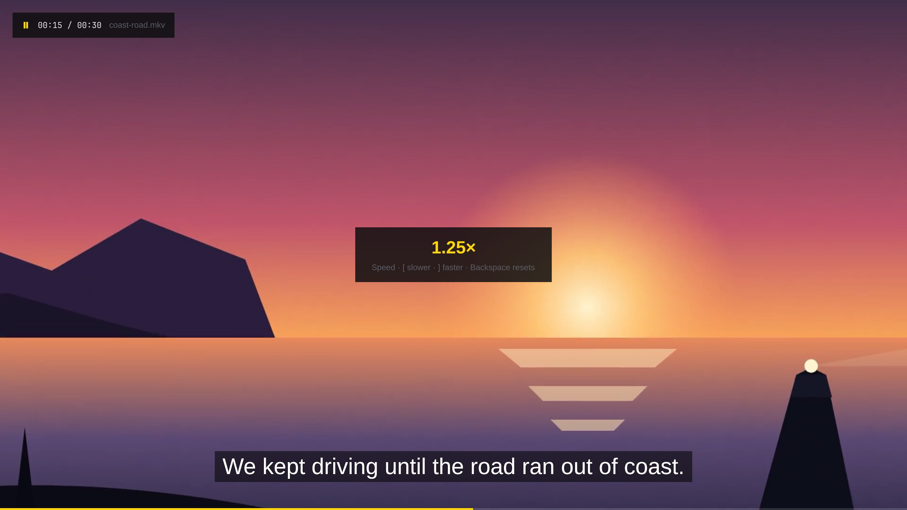
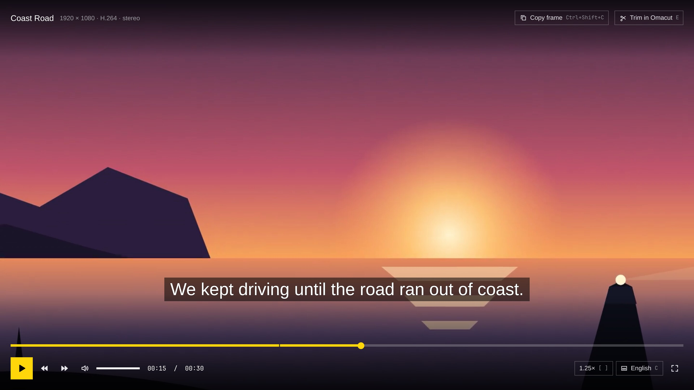

# Showtime

Omarchy's media player. Open a video or a song and watch it, with nothing on screen but the picture and a thin line that says how far along you are. Every key answers with a short on-screen display, and Tab brings in the controls when you want them.

Showtime plays through ffmpeg: Qt Multimedia's FFmpeg backend decodes, on the GPU where it can, and the `ffmpeg` and `ffprobe` tools read chapters and track details, make the scrub previews, read subtitles, and grab exact frames.

## Command line

`showtime movie.mkv` (or `showtime open movie.mkv`) plays a file, with the other videos and songs in its folder as the playlist. Several files given at once are the playlist, in that order. A URL plays what ffmpeg can open.

These need no display, take `--json`, and exit 0 or 1 with the reason on stderr:

- `showtime info <file>` — duration, streams, chapters, and where Showtime would resume.
- `showtime frame <file> --at 1:02:03 -o still.png` — the exact frame at a time.
- `showtime skill install` — installs a short skill for coding agents.

## Shortcuts

| Key | Action |
|---|---|
| `Space` `K` | Play or pause |
| `←` `→` / `Shift+←` `→` / `J` `L` | Back or forward 5 seconds / 1 second / 10 seconds |
| `0`–`9` / `Home` | Jump to that tenth of the way / back to the start |
| `,` `.` | Step one frame back or forward |
| `PgUp` `PgDn` | Previous or next chapter |
| `[` `]` / `Backspace` | Slower or faster / normal speed |
| `↑` `↓` / `M` | Louder or quieter / mute |
| `C` / `A` | Next subtitles, or off / next audio track |
| `Tab` | Show or hide the controls |
| `F` / `Esc` | Fullscreen / leave fullscreen or hide the controls |
| `N` `P` | Next or previous file |
| `Enter` | At the end of a file, play the next one |
| `I` | What's in the file: streams, codecs, chapters |
| `Ctrl+Shift+C` / `Ctrl+S` | Copy the frame / save it as a PNG |
| `E` | Trim in Omacut |
| `Ctrl+O` | Open files |
| `?` | Every shortcut |
| `Q` | Quit |

Click the picture to play or pause, double-click it for fullscreen, and scroll for volume. The bottom edge grows into a timeline with preview frames when the pointer comes near it.

## What it remembers

Where you stopped in anything longer than five minutes, so it resumes there (Home starts over), and forgets once you reach the end. The volume, and the subtitle and audio languages you last picked. They live in `~/.local/state/showtime/positions.json`, keyed by a hash of each file's path, size and time, so the file holds no names.

Subtitles start off unless the film speaks a language other than yours and has subtitles in yours. Files beside the video named after it (`movie.srt`, `movie.en.srt`, `.vtt`, `.ass`) are offered too. Bitmap subtitle tracks (PGS, VobSub) aren't shown, and the info card says so.

While a video plays, Showtime keeps the screen from going to sleep. Media keys, `playerctl` and the bar's now-playing reach it through MPRIS.

Showtime speaks the language picked under Omarchy's Setup > Language, follows the theme, and mirrors for right-to-left languages.

## Requirements

- Qt 6 with Multimedia: `qt6-base`, `qt6-declarative`, `qt6-multimedia` and `qt6-multimedia-ffmpeg`, `qt6-svg`, `qt6-wayland`
- `ffmpeg`, for `ffprobe` and `ffmpeg`
- `wl-clipboard`, so a copied frame outlives Showtime
- `xdg-desktop-portal` and a backend, for the open and save dialogs
- To build: `cmake`, `wayland-protocols`

## Development

`bin/build` builds into `build/`, and `bin/test` builds and runs every test offscreen: the backend against clips ffmpeg makes at test time, the real window driven by keys, and the command line as an agent uses it. `cmake --install build --prefix ~/.local` puts Showtime in the launcher before it is packaged.

## License

MIT. The theme, translator and portal file picker come from Omarchy's other apps (MIT, David Heinemeier Hansson).
